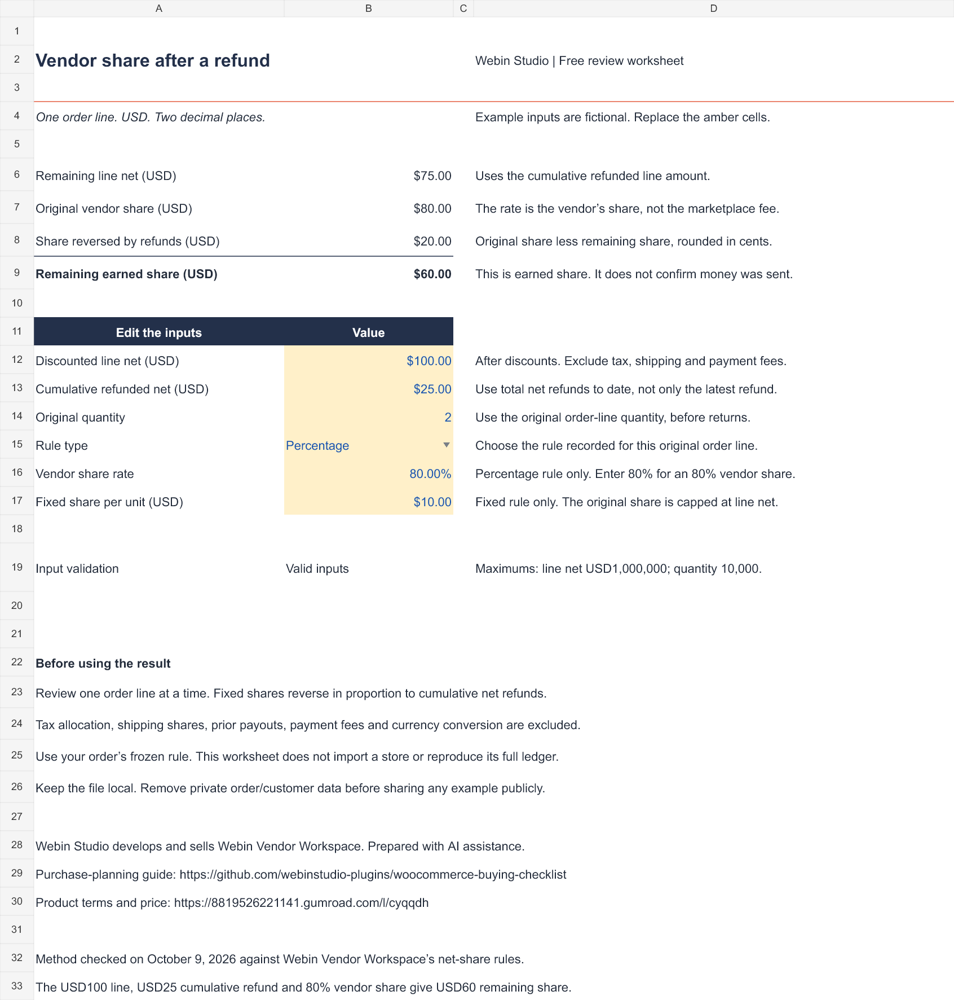

# Review a vendor share after a refund

[Download the free Excel worksheet](vendor-share-review.xlsx). Open it locally and replace the amber input cells. The file contains formulas, a rule selector and input warnings. It has no macros, store connection or customer data.

Webin Studio develops and sells Webin Vendor Workspace. This worksheet was prepared with AI assistance to help merchants and developers inspect one order line before evaluating a vendor workflow.

## Read the percentage correctly

The percentage is the **vendor’s share**. For a USD100 discounted line net, USD25 in cumulative net refunds and an 80% vendor share, the remaining earned share is USD60. The original USD80 share is reduced by USD20. These are fictional amounts.

## Choose the original rule

- **Percentage:** apply the vendor share rate to the remaining net amount and round to whole cents.
- **Fixed per unit:** multiply the fixed share by the original quantity, cap the original share at discounted line net, then reverse it in proportion to cumulative net refunds.

Use the rule recorded for the original order line. Changing today’s product settings does not establish the rule for an older order. The worksheet supports USD amounts with two decimal places, a nonnegative line net up to USD1,000,000 and original integer quantities from 1 to 10,000. Enter percentage rates in 0.01% steps. Unsupported or missing inputs leave calculated amounts blank and show a specific input warning.

## Keep earned share separate from payment

The worksheet covers the net item share only. Tax allocation, shipping shares, prior payouts, payment-processing fees and currency conversion are excluded. A remaining earned share does not prove that a vendor is still owed that amount: reconcile prior verified transfers and the actual ledger separately.

This file does not import a store or reproduce Webin Vendor Workspace’s complete ledger, tax policies, permissions, settlement checks or payout process. Keep private order and customer information out of public issues and examples.

## Check the product before buying

[Open the free WooCommerce buying checklist](https://demo.webinstudio.co.kr/resources/woo-buying/?utm_source=github&utm_medium=community&utm_campaign=webin_first_customer_202610&utm_content=woo_developer_checklist_en_v1) for hosting, payment, updates and support questions.

[Webin Vendor Workspace product details](https://8819526221141.gumroad.com/l/cyqqdh) list the annual USD99 update/support service for one site and the current purchase terms. Using this free worksheet requires no purchase. It does not extend the product’s support or refund terms.

## Verification and use

On October 9, 2026, the worksheet was recalculated with 20 valid and invalid input cases. Ten valid cases were also compared directly with the product’s current net-share PHP calculation. The exported XLSX was reopened in the authoring engine, and its formulas and preview were checked. Microsoft Excel and Google Sheets operation have not been separately verified.

You may use and modify this worksheet for your own store or client planning. Preserve Webin Studio attribution and the calculation scope when redistributing it. This permission applies to this free worksheet and guide; it grants no license to the paid plugin.
